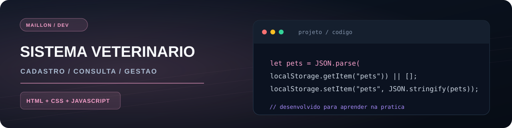
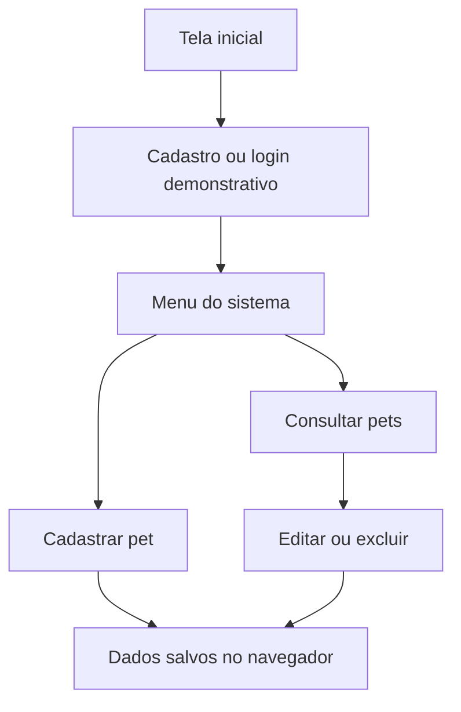

<p align="center"></p>
# Sistema Veterinário
    

> Aplicação web educacional para cadastro e consulta de pets, com login demonstrativo e dados armazenados no próprio navegador.

🐾 **[Abrir demonstração](https://maillon49-prog.github.io/Sistema-veterin-rio/)** · 💻 **[Ver código](https://github.com/maillon49-prog/Sistema-veterin-rio)**

## ✨ Funcionalidades atuais
- 👤 Cadastro e login de usuários (modo demonstrativo)
- 🐶 Cadastro de pets com nome, espécie, raça, idade e tutor
- 🔍 Consulta dos pets cadastrados
- ✏️ Edição e exclusão de cadastros
- ✅ Validação de campos obrigatórios e verificação de duplicidade
- 💾 Persistência de usuários e pets no `localStorage`
- 🧭 Navegação entre as telas pelo menu

## 🛠️ Tecnologias
| Interface | Lógica | Persistência |
| :-- | :-- | :-- |
| HTML e CSS | JavaScript e DOM | `localStorage` |

## 🧭 Como funciona


## 🐕 Campos do cadastro
| Campo | Exemplo de informação |
| :-- | :-- |
| Nome | Nome do pet |
| Espécie | Cão ou gato |
| Raça | Raça do animal |
| Idade | Idade informada |
| Dono | Nome do tutor |

## 🚀 Executar
Não é necessário instalar Node.js nem configurar um banco de dados para testar esta versão.

1. Clone ou baixe o repositório.
2. Abra `index.html` no navegador.
3. Faça um cadastro demonstrativo e acesse o menu.

## 📁 Arquivos principais
```text
Sistema-veterin-rio/
├── index.html      # Tela inicial
├── script.js       # Cadastro e login demonstrativos
├── menu.html       # Menu e telas do sistema
├── menuJS.js       # Lógica de gerenciamento dos pets
├── style.css       # Estilo da tela inicial
└── menu.css        # Estilo do painel
```

## 🗺️ Próximos passos
- [ ] Concluir o gerenciamento de medicamentos e a consulta ao estoque, que ainda têm partes em desenvolvimento
- [ ] Evoluir a autenticação e o armazenamento para um back-end com banco de dados

> ⚠️ **Projeto de estudo:** os dados, inclusive as credenciais demonstrativas, ficam no `localStorage` do navegador. **Não use senhas reais.** Esta versão não implementa autenticação segura para produção.

## 🎯 O que pratiquei
Manipulação do DOM, formulários, validação de entrada, operações CRUD, persistência no navegador e organização de várias telas.

---

### 👨‍💻 Autor

Desenvolvido por **Maillon Andrade de Oliveira**, como parte dos meus estudos e projetos práticos de programação.

[GitHub](https://github.com/maillon49-prog) · [Portfólio](https://github.com/maillon49-prog/Portifolio)
